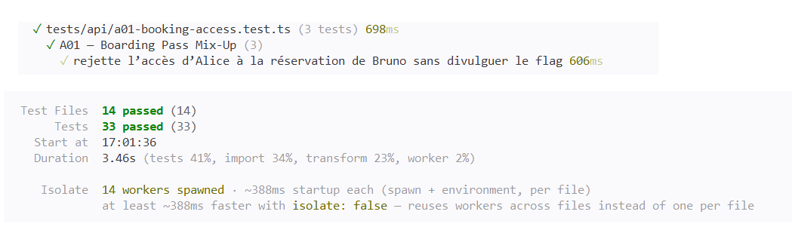

# A01 — Boarding Pass Mix-Up

## Vulnerability

En testant l'affichage des détails d'une réservation, j'ai constaté que `GET /api/bookings/:id` renvoie n'importe quelle réservation à n'importe quel client connecté, quel que soit son propriétaire. Connecté en tant qu'Alice, j'ai pu lire la réservation de Bruno : nom et e-mail du voyageur, notes d'itinéraire, statut du paiement et quatre derniers chiffres de sa carte. La réponse contenait aussi le flag du défi (enregistré dans `flag.txt`).

L'impact est une fuite de données personnelles et de voyage d'un client vers un autre. Il s'agit d'un défaut de contrôle d'accès au niveau objet (BOLA / IDOR), catégorie A01 (Broken Access Control) de l'OWASP Top 10:2025.

## Exploitation

Tout a été réalisé en local, en lecture seule, avec les seuls comptes de démonstration.

1. Je me suis connecté en tant qu'Alice (`alice.martin@example.test`) et j'ai ouvert l'un de ses voyages.
2. Dans les DevTools du navigateur (onglet Network), j'ai vu que la fenêtre de détails appelle `GET /api/bookings/<booking-id>` avec un en-tête `Authorization: Bearer <token>`. L'UUID de la réservation est la seule valeur qui identifie le dossier demandé.
3. J'ai rejoué la même requête avec la session d'Alice, mais en remplaçant l'identifiant par l'UUID de la réservation de Bruno (`40000000-0000-4000-8000-000000000002`) :

```bash
curl -s http://127.0.0.1:8080/api/bookings/40000000-0000-4000-8000-000000000002 \
  -H "Authorization: Bearer <ALICE_TOKEN_REDACTED>"
```

4. L'API a répondu `200 OK` avec la réservation de Bruno, et le champ `itinerary_notes` contenait le flag.

Preuve : `vulnerability.png` (réponse montrant le flag, token masqué).

## Root Cause

`requireUser` ne fait que de l'**authentification** : il lit le token Bearer, retrouve la session dans PostgreSQL et indique à l'API *qui* fait la requête. Il ne vérifie pas si cet utilisateur a le droit d'accéder à la ressource demandée.

Dans `apps/api/src/routes/bookings.ts`, la route de détail chargeait la réservation avec `WHERE b.id=$1` uniquement, à partir d'un identifiant entièrement contrôlé par le client. Aucun contrôle d'autorisation au niveau de l'objet n'était effectué, alors que `canReadBooking` existait déjà dans `domain.ts`. La route de liste (`GET /api/bookings`) filtrait correctement par `b.user_id`, donc l'interface n'affichait que les voyages d'Alice, mais la route de détail acceptait n'importe quel UUID. La route ajoutait même le flag précisément quand `booking.user_id !== request.authUser.id`, ce qui montre l'absence de contrôle.

Le navigateur ne peut pas être une frontière de sécurité : masquer des données dans l'interface React n'empêche pas de rejouer ou de modifier des requêtes HTTP directement (DevTools, `curl`, n'importe quel client HTTP). L'API doit appliquer l'autorisation à chaque requête sur une ressource protégée.

## Remediation

Dans `GET /api/bookings/:id`, une fois la réservation chargée, l'API appelle maintenant `canReadBooking(request.authUser, booking.user_id)` :

- le propriétaire et les utilisateurs ayant le rôle `support` sont autorisés ;
- toute autre personne reçoit `404 Réservation introuvable`, la même réponse que pour une réservation inexistante, de sorte que l'API ne confirme jamais qu'un identifiant est valide (moins de divulgation d'information) ;
- j'ai supprimé le code qui injectait le flag, donc aucune réponse de cette route ne le contient plus.

L'authentification (`requireUser`) est inchangée, et l'identifiant est toujours validé avec `isUuid` (400 s'il est invalide).

Preuve : `remediation.png` (même requête d'Alice sur la réservation de Bruno, désormais rejetée avec un 404 et sans flag, token masqué).

## Verification

J'ai mis à jour `tests/api/a01-booking-access.test.ts` :

- **Régression de sécurité** : Alice qui demande la réservation de Bruno reçoit `404`, et le corps ne contient ni `FLAG{` ni aucune donnée de Bruno.
- **Test métier positif** : Alice peut toujours lire sa propre réservation (`200`).
- **Accès support** : un utilisateur support peut toujours lire une réservation à partir de son identifiant (`200`).

J'ai exécuté la suite complète dans Docker (`docker compose build app` puis `docker compose run --rm --no-deps app npm test`) et tout passe.

Preuve : `passing-tests.png` (suite complète au vert, y compris les trois tests A01).

