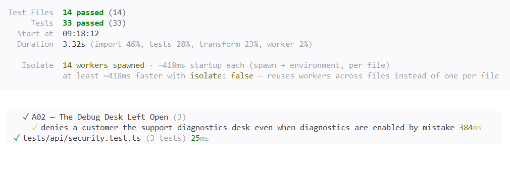

# A02 — The Debug Desk Left Open

## Vulnerability

La route `GET /api/support/diagnostics`, un « Debug Desk » destiné uniquement à l'équipe support (`intendedAudience: "support"`), était accessible à n'importe quel client connecté. Avec la session d'Alice (compte `customer`), j'ai obtenu un `200 OK` et le contenu complet du bureau de debug :

- l'environnement d'exécution (`runtime.environment: "production"`) et la version de Node.js ;
- la cartographie des services internes (`app:8080`, `db:5432`, `fake-payment:8081`, `fake-mail:8082`) ;
- une note d'opérateur (`operatorNote`) confirmant que le desk avait été laissé ouvert ;
- le flag du défi (enregistré dans `flag.txt`).

L'impact est une fuite d'informations techniques internes vers un utilisateur non autorisé. Un attaquant peut s'en servir pour cartographier l'infrastructure et préparer d'autres attaques. Il s'agit d'une mauvaise configuration de sécurité, OWASP Top 10:2025 A02 (Security Misconfiguration), combinée à un contrôle d'autorisation manquant.

## Exploitation

Tout a été réalisé en local, en lecture seule, avec les comptes de démonstration uniquement.

1. J'ai appelé une route ordinaire de l'API pour inspecter les en-têtes de réponse :

```bash
curl -i http://127.0.0.1:8080/api/health
```

La réponse contenait un en-tête inhabituel, absent des contrôles de sécurité classiques : `x-holbietrips-debug-desk: /api/support/diagnostics`. Il révèle le chemin d'une fonctionnalité que l'interface ne montre pas.

2. Je me suis connecté dans le navigateur en tant qu'Alice (`alice.martin@example.test`, rôle `customer`) et j'ai récupéré le token de sa session.
3. Depuis la Console des DevTools, j'ai rejoué une requête vers le chemin trouvé, avec la session d'Alice :

```js
fetch("http://127.0.0.1:8080/api/support/diagnostics", {
  headers: { "authorization": "Bearer <ALICE_TOKEN_REDACTED>" }
}).then(r => r.json()).then(d => console.log(JSON.stringify(d, null, 2)));
```

4. L'API a répondu `200 OK` avec le contenu du Debug Desk décrit ci-dessus, dont le champ `flag`.

Aucun bouton ni lien de l'interface React ne mène à cette route : la découverte passe uniquement par l'en-tête de réponse, puis par un appel direct à l'API.

Preuve : `vulnerability.png` (statut 200, `intendedAudience: support`, flag visible, token masqué).

## Root Cause

Le problème vient de deux défaillances indépendantes qui se cumulent.

**1. Une mauvaise configuration (A02, Security Misconfiguration).** Le réglage `SUPPORT_DIAGNOSTICS_ENABLED` (lu dans `apps/api/src/config.ts`) est fixé à `"true"` dans `compose.yaml`, alors que l'application tourne avec `NODE_ENV=production` (valeur visible dans la réponse de la route). Une fonctionnalité de debug destinée au support était donc activée par défaut dans un environnement de type production. Ce réglage a deux effets : dans `apps/api/src/app.ts`, il ajoute l'en-tête `x-holbietrips-debug-desk: /api/support/diagnostics` aux réponses (la « piste » repérée dans l'onglet Network), et dans `apps/api/src/routes/system.ts`, il décide si la route est enregistrée (`if (!diagnosticsEnabled) return;`). L'en-tête rendait donc la fonctionnalité détectable par n'importe quel visiteur.

**2. Une autorisation manquante.** La route `GET /api/support/diagnostics` n'était protégée que par `preHandler: context.requireUser`. Comme dans A01, `requireUser` ne fait que de l'authentification : il vérifie qu'une session est valide, sans regarder le rôle. N'importe quel client connecté pouvait donc ouvrir un outil « destiné au support » (`intendedAudience: 'support'`) et lire des informations internes ainsi que le flag. À l'inverse, la route `PATCH /api/support/tickets/:id` utilise correctement `context.requireRole('support')`, ce qui montre que le bon contrôle existait déjà dans le projet mais n'avait pas été appliqué ici.

**Pourquoi corriger les deux ?** Chaque défaillance seule suffit à créer l'exposition : tant que le réglage est actif, la route est accessible à tous si le contrôle de rôle manque ; tant que le contrôle de rôle manque, une simple réactivation du réglage par erreur rouvre la faille. La désactivation de la configuration réduit la surface d'attaque (la route n'existe plus), et `requireRole('support')` garantit que, même réactivée, la route reste réservée au support. C'est le principe de défense en profondeur. Une session client valide ne suffisait pas comme protection, car elle prouve seulement qui est l'utilisateur, pas qu'il a le droit d'utiliser un outil réservé au support.

## Remediation

J'ai appliqué deux corrections indépendantes :

- **Configuration** : dans `compose.yaml`, `SUPPORT_DIAGNOSTICS_ENABLED` passe de `"true"` à `"false"`. Par défaut, la route n'est plus enregistrée et l'en-tête `x-holbietrips-debug-desk` n'est plus envoyé.
- **Autorisation** : dans `apps/api/src/routes/system.ts`, `context.requireUser` est remplacé par `context.requireRole('support')`. Même si le réglage est réactivé par erreur, un client reçoit un `403 Forbidden`.

Le parcours normal n'est pas touché : `/api/health` et le catalogue (`/api/trips`) fonctionnent toujours, et le support peut utiliser le desk lorsque celui-ci est volontairement activé.

Après reconstruction de l'application, la même requête d'Alice vers `/api/support/diagnostics` renvoie un `404` (`Ressource introuvable`) et aucune donnée. Ce `404` vient de la couche configuration : la route n'est plus enregistrée. Le `403` de la couche autorisation est vérifié par les tests, qui forcent `diagnosticsEnabled: true` pour simuler la réactivation par erreur.

Preuve : `remediation.png` (même requête d'Alice, désormais rejetée, sans flag ni donnée interne, token masqué).

## Verification

J'ai mis à jour `tests/api/a02-security-misconfiguration.test.ts`, qui contient trois tests :

- **Régression de sécurité** : avec `diagnosticsEnabled: true` (réactivation par erreur), un client reçoit `403`, et le corps ne contient ni `FLAG{`, ni `fake-payment`, ni `Debug Desk`. Ce test remplace l'ancien test qui caractérisait la faille (client → `200`).
- **Test métier positif (support)** : avec les diagnostics activés, le support reçoit `200` et `intendedAudience` vaut `support`.
- **Test métier positif (catalogue)** : avec `diagnosticsEnabled: false`, la route renvoie `404`, l'en-tête `x-holbietrips-debug-desk` est absent, et le catalogue `/api/trips` répond toujours `200`.

Les deux couches de la défense sont ainsi testées séparément : l'autorisation (test 1) et la configuration (test 3).

J'ai exécuté la suite complète dans Docker (`docker compose build app` puis `docker compose run --rm --no-deps app npm test`) : 14 fichiers de tests et 33 tests passent, sans régression sur les autres défis.

Preuve : `passing-tests.png` (suite complète au vert, dont les trois tests A02).

