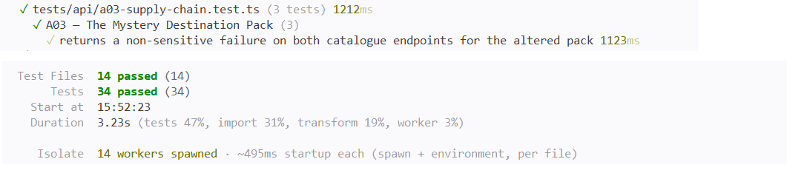

# A03 — The Mystery Destination Pack

## Vulnerability

HolbieTrips importe un « Destination Pack » (fichier JSON du fournisseur fictif HolbieTripsSync) qui ajoute des conseils de voyage aux réponses du catalogue. L'application connaît l'empreinte SHA-256 attendue du pack approuvé et calcule celle du fichier réellement lu, mais **elle ne s'en sert jamais pour décider**. Un pack modifié est donc accepté et servi publiquement, sans connexion, par `GET /api/destination-pack` et par `GET /api/trips`.

Le pack chargé par défaut était le pack modifié : seul le `travelTip` de `kyoto-saisons` diffère du pack approuvé (« Unofficial night route accepted by the altered destination pack »), et c'est dans ce conseil que se trouvait le flag (enregistré dans `flag.txt`).

L'impact est l'injection de contenu non approuvé dans les réponses publiques de l'application. Ici il s'agit d'un simple conseil de voyage, mais avec un vrai fournisseur compromis, le même défaut permettrait d'introduire n'importe quelle donnée non vérifiée. C'est une défaillance de la chaîne d'approvisionnement logicielle, OWASP Top 10:2025 A03 (Software Supply Chain Failures).

## Exploitation

Tout a été réalisé en local, en lecture seule. Aucune connexion n'est nécessaire, car la route est publique.

1. J'ai comparé les deux fichiers de `database/fixtures/` : seul le `travelTip` de `kyoto-saisons` diffère.
2. J'ai lu `compose.yaml` : `DESTINATION_PACK_FILE` pointait vers `/workspace/database/fixtures/destination-pack-altered.json`, alors que `DESTINATION_PACK_SHA256` contenait l'empreinte de confiance (`78f5ba6c…4bc93`).
3. J'ai lu le chargeur `apps/api/src/destination-pack.ts` : l'empreinte est calculée, mais `accepted` est codé en dur à `true`.
4. J'ai interrogé l'API :

```bash
curl -s http://127.0.0.1:8080/api/destination-pack | python3 -m json.tool
```

5. La réponse était un `200 OK` avec l'objet `integrity` : `expected` et `calculated` étaient **différents**, et pourtant `accepted` valait `true`. Le `travelTip` de `kyoto-saisons` contenait le flag.

Preuve : `vulnerability.png` (réponse montrant les empreintes différentes, `accepted: true` et le flag).

## Root Cause

Le problème vient de trois défaillances qui se cumulent le long de la chaîne « lecture du fichier → vérification → utilisation ».

**1. Une vérification d'intégrité qui n'en est pas une (`apps/api/src/destination-pack.ts`).** La fonction `loadDestinationPack` lit le fichier, calcule bien son empreinte SHA-256 (`calculatedSha256`), mais ne la compare jamais à l'empreinte attendue (`expectedSha256`). Le champ `accepted` est codé en dur à `true` : il ne reflète aucune décision. Pire, le JSON est analysé (`JSON.parse`) avant toute vérification, et le pack est renvoyé de façon inconditionnelle. L'objet `integrity` n'est qu'un rapport d'information, pas un garde-fou : il affiche même `expected` et `calculated` différents avec `accepted: true`.

**2. Des routes qui consomment le pack sans rien décider (`apps/api/src/routes/catalog.ts`).** Les deux consommateurs du chargeur, `GET /api/destination-pack` et `GET /api/trips` (via `getDestinationPack()`), utilisent le pack sans jamais lire `integrity.accepted`, et aucun `if` ni `throw` n'interrompt le traitement quand les empreintes diffèrent. Le seul `if` de `getDestinationPack` sert à injecter le flag dans le conseil de Kyoto : c'est un marqueur du défi, pas un contrôle de sécurité. Le contenu non approuvé (`travelTip` de `kyoto-saisons`) arrive donc tel quel dans les réponses publiques, sans authentification.

**3. Un artefact non approuvé configuré comme entrée par défaut (`compose.yaml`).** Le fichier chargé par défaut était le pack modifié : `DESTINATION_PACK_FILE` pointait vers `/workspace/database/fixtures/destination-pack-altered.json`, alors que `DESTINATION_PACK_SHA256` contenait l'empreinte de confiance (`78f5ba6c…4bc93`). L'application disposait donc de l'information nécessaire pour détecter le problème (une valeur de confiance et une valeur réellement lue), mais n'en tirait aucune conséquence.

**Pourquoi corriger un seul point ne suffit pas.** Si je ne corrige que le calcul de `accepted`, le pack est quand même analysé puis renvoyé par les routes, qui ne lisent pas ce champ. Si je ne corrige que les routes, elles dépendent d'une valeur `accepted` toujours vraie. Et si je ne remplace que le fichier par défaut dans `compose.yaml`, l'application continuerait de faire confiance à n'importe quel fichier dont l'empreinte est mauvaise le jour où l'un d'eux serait de nouveau configuré. La vérification doit donc être appliquée à la source, dans le chargeur : comparer les empreintes **avant** `JSON.parse` et lever une erreur en cas de différence, de sorte qu'aucune route ne puisse utiliser un contenu non vérifié.

## Remediation

J'ai appliqué trois modifications :

- **`apps/api/src/destination-pack.ts`** : après le calcul de l'empreinte, et **avant** `JSON.parse`, le chargeur compare `calculatedSha256` à `expectedSha256` et lève une erreur (`Destination pack integrity check failed`) en cas de différence. Le message ne contient ni empreinte ni chemin de fichier. `accepted: true` n'est plus qu'une conséquence logique : le code ne l'atteint que si la comparaison a réussi.
- **`apps/api/src/routes/catalog.ts`** : j'ai supprimé le bloc qui injectait le flag et simplifié `getDestinationPack` en un simple appel au chargeur. Je n'ai ajouté aucun `try/catch` : l'erreur remonte au gestionnaire d'erreurs global de `app.ts`, qui renvoie un `500` avec le message générique `Une erreur interne est survenue`, sans stack trace ni détail interne.
- **`compose.yaml`** : `DESTINATION_PACK_FILE` pointe désormais vers `/workspace/database/fixtures/destination-pack-approved.json`. Je n'ai pas touché à l'empreinte de confiance : la remplacer par celle du fichier modifié aurait seulement fait disparaître le symptôme.

Le pack approuvé reste le fonctionnement normal : le catalogue et `/api/destination-pack` continuent de répondre.

Preuve : `remediation.png` (réponse de `/api/destination-pack` après correction : `expected` et `calculated` identiques, `accepted: true`, aucun flag ni contenu modifié).

## Verification

`remediation.png` montre que le site réel sert maintenant le **pack approuvé** : c'est le comportement normal restauré, car le serveur ne charge plus le pack modifié par défaut. Cette capture ne montre pas le rejet du pack modifié, car l'attaque ne dépend pas d'une action du client mais du fichier que le serveur charge. Le rejet effectif est prouvé par le test automatisé `returns a non-sensitive failure on both catalogue endpoints for the altered pack`, visible dans `passing-tests.png`.

J'ai mis à jour `tests/api/a03-supply-chain.test.ts`, qui contient maintenant trois tests. Chacun force explicitement le fichier utilisé (par `vi.stubEnv` et un nouvel import de l'application), sans dépendre de la valeur par défaut de `compose.yaml` :

- **Régression de sécurité (chargeur)** : `loadDestinationPack` appelé avec le pack modifié et l'empreinte approuvée est rejeté, et le message d'erreur ne contient ni l'empreinte ni le nom du fichier.
- **Régression de sécurité (HTTP)** : avec le pack modifié, `/api/destination-pack` et `/api/trips` répondent `500`, et le corps ne contient ni `FLAG{`, ni `Unofficial night route`, ni l'empreinte.
- **Test métier positif** : avec le pack approuvé, le chargeur accepte le fichier, `/api/destination-pack` et `/api/trips` répondent `200` sans flag, et le `travel_tip` de Kyoto correspond au contenu du pack approuvé.

J'ai exécuté la suite complète dans Docker (`docker compose build app` puis `docker compose run --rm --no-deps app npm test`) : 14 fichiers de tests et 34 tests passent, sans régression sur les autres défis.

Preuve : `passing-tests.png` (suite complète au vert, dont les trois tests A03).

