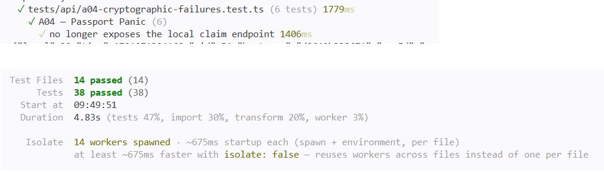

# A04 — Passport Panic

## Vulnerability

Le numéro de passeport des voyageurs est stocké en base dans la table `traveler_profiles` (colonnes `passport_ciphertext`, `passport_iv`, `passport_tag`), mais il n'est pas chiffré : il est seulement **encodé en base64**. La colonne s'appelle « ciphertext » et la valeur a l'air brouillée, mais n'importe qui qui lit une copie de la base peut retrouver le passeport en clair, sans aucune clé.

Pour le profil seedé de Bruno, la base contenait `passport_ciphertext = RlItREVNTy1CUlVOTy04NzQy` et `passport_iv = legacy-base64`. Un simple décodage base64 donnait le numéro de passeport fictif `FR-DEMO-BRUNO-8742`. Le soumettre à l'endpoint local de validation (`POST /api/challenges/a04/claim`) renvoyait le flag (enregistré dans `flag.txt`).

L'impact est une perte de confidentialité des données au repos : un export ou une copie de la base expose les documents d'identité de tous les voyageurs. Il s'agit d'une défaillance cryptographique, OWASP Top 10:2025 A04 (Cryptographic Failures).

## Exploitation

Tout a été réalisé en local, avec des données fictives uniquement.

1. J'ai identifié la table et les colonnes dans `database/migrations/001_initial.sql` (`traveler_profiles`) et le profil seedé contenant un passeport dans `database/seeds/001_demo.sql` (celui de Bruno ; celui d'Alice est vide).
2. J'ai lu le code qui protège et restaure la valeur dans `apps/api/src/security.ts` et `apps/api/src/routes/profile.ts` : le marqueur `legacy-base64` fait contourner totalement la clé de chiffrement.
3. J'ai lu directement la valeur en base, sans passer par l'API, ce qui simule un export compromis :

```bash
docker compose exec db psql -U holbie -d holbietrips -c \
  "SELECT passport_ciphertext, passport_iv FROM traveler_profiles WHERE user_id='10000000-0000-4000-8000-000000000002';"
```

Résultat : `RlItREVNTy1CUlVOTy04NzQy | legacy-base64`.

4. J'ai décodé la valeur sans aucune clé :

```bash
python3 -c "import base64; print(base64.b64decode('RlItREVNTy1CUlVOTy04NzQy').decode())"
```

Résultat : `FR-DEMO-BRUNO-8742`.

5. Depuis la Console du navigateur, avec une session locale authentifiée, j'ai soumis ce numéro à l'endpoint de validation :

```js
fetch("http://127.0.0.1:8080/api/challenges/a04/claim", {
  method: "POST",
  headers: {
    "authorization": "Bearer <TOKEN_REDACTED>",
    "content-type": "application/json"
  },
  body: JSON.stringify({ passportNumber: "FR-DEMO-BRUNO-8742" })
}).then(r => { console.log("status:", r.status); return r.json(); }).then(console.log);
```

6. L'API a répondu `200` avec le flag.

Preuve : `vulnerability.png` (réponse `200` avec le flag, token masqué).

## Root Cause

Le problème vient de plusieurs défaillances qui se cumulent.

**1. Un mode « legacy » qui contourne la clé (`apps/api/src/security.ts`).** La fonction `protectPassport` applique le mode de protection configuré : en mode `legacy-base64`, elle se contente d'encoder la valeur en base64 et enregistre le marqueur `legacy-base64` à la place d'un vrai vecteur d'initialisation, avec un `tag` nul. De son côté, `revealPassport` teste ce marqueur (`iv === 'legacy-base64'`) et décode simplement le base64, sans jamais utiliser `keyHex` (la clé de l'application). Le base64 est un encodage réversible sans secret, pas un chiffrement : cette branche n'offre aucune confidentialité. Une colonne nommée `passport_ciphertext` ne prouve pas qu'une clé a été utilisée.

**2. Un mode faible activé par défaut (`apps/api/src/config.ts` et `compose.yaml`).** `config.ts` définissait `passportProtectionMode` avec la valeur par défaut `legacy-base64`, et `compose.yaml` fixait aussi `PASSPORT_PROTECTION_MODE: legacy-base64`. Chaque mise à jour du profil (`PUT /api/me`) protégeait donc aussi les nouveaux passeports avec le mode faible : le problème ne concernait pas que les données historiques.

**3. Un enregistrement historique déjà stocké de façon faible (`database/seeds/001_demo.sql`).** Le profil seedé de Bruno contenait directement la valeur base64 et le marqueur `legacy-base64`. Changer uniquement le mode d'écriture ne modifie que les futures sauvegardes : la ligne déjà en base reste lisible sans clé tant qu'elle n'est pas migrée. Modifier le seed ne change pas non plus un volume PostgreSQL existant, car les fichiers SQL ne se rejouent que sur un volume vide.

**4. Un chiffrement correct déjà présent mais non utilisé.** `encryptSensitive` et `decryptSensitive` implémentent déjà AES-256-GCM, avec un nonce aléatoire, un tag d'authentification et la vérification de la clé de 32 octets. `protectPassport` savait les appeler pour tout mode différent de `legacy-base64`, et `revealPassport` savait lire les deux formats. Il n'y avait donc pas de cryptographie à inventer : le défaut était le choix du mode et l'absence de migration.

**5. Un endpoint de validation à retirer (`apps/api/src/routes/profile.ts`).** La route `POST /api/challenges/a04/claim` comparait le SHA-256 de la valeur soumise à une empreinte fixe du passeport en clair. C'est un marqueur du défi, pas une fonctionnalité métier : il ne doit pas subsister après la migration.

**Pourquoi corriger un seul point ne suffit pas.** Si je change seulement le mode d'écriture, les futurs passeports seront chiffrés mais celui de Bruno resterait lisible en base. Si je migre seulement la ligne existante sans changer le mode, la prochaine sauvegarde d'un profil réintroduirait une valeur faible. Et si je corrige le seed sans migrer la base existante, un volume déjà créé garderait l'ancienne valeur.

## Remediation

J'ai réutilisé le chiffrement authentifié déjà présent dans le dépôt, sans écrire de cryptographie moi-même. J'ai appliqué les modifications suivantes :

- **`apps/api/src/security.ts`** : j'ai supprimé la branche `legacy-base64` des deux fonctions. `protectPassport` n'accepte plus que le mode `aes-256-gcm` et lève une erreur pour tout autre mode, puis appelle `encryptSensitive`. `revealPassport` exige un `iv` et un `tag` et appelle `decryptSensitive`. Un enregistrement qui garderait l'ancien marqueur n'est donc plus lisible : l'échec est fermé plutôt qu'une lecture faible.
- **`apps/api/src/config.ts` et `compose.yaml`** : le mode par défaut et `PASSPORT_PROTECTION_MODE` valent maintenant `aes-256-gcm`, un nom qui décrit l'algorithme réellement utilisé.
- **`database/seeds/001_demo.sql`** : j'ai remplacé la valeur base64 de Bruno par un triplet `ciphertext` / `iv` / `tag` produit par la fonction existante `encryptSensitive`, appelée une seule fois dans le conteneur avec la clé locale de l'application. Le `INSERT` nomme maintenant les sept colonnes, dont `passport_tag`, et la ligne d'Alice a un `NULL` pour chacune des trois colonnes de passeport. Les anciens enregistrements sont donc migrés pour une nouvelle installation.
- **Volume existant** : comme modifier le seed ne change pas la base déjà créée, j'ai réinitialisé les données locales (`docker compose down -v`, puis `docker compose up --build -d`) pour que le nouveau seed s'applique.
- **`apps/api/src/routes/profile.ts`** : j'ai supprimé entièrement la route `POST /api/challenges/a04/claim` et retiré `tokenDigest` de l'import de ce fichier (la fonction reste dans `security.ts`). La route ne peut plus renvoyer de flag avec l'ancienne preuve.

Vérifications manuelles après la correction :

- La lecture directe en base ne donne plus de valeur décodable : `passport_ciphertext` est un contenu chiffré, `passport_iv` n'est plus `legacy-base64`, et `passport_tag` est renseigné.
- Connecté en Bruno, `GET /api/me` affiche toujours `FR-DEMO-BRUNO-8742` : cette fois la valeur est déchiffrée avec la clé de l'application.
- La même tentative qu'au début, soumettre le passeport à la route de claim, renvoie `404 Not Found` avec `{"error":"Ressource introuvable"}` et aucun flag.

Preuve : `remediation.png` (`curl -i` vers `/api/challenges/a04/claim` avec le même `passportNumber` : `404`, sans flag).

## Verification

J'ai réécrit entièrement `tests/api/a04-cryptographic-failures.test.ts`, car les deux anciens tests caractérisaient la faille (mode legacy et route de claim). Il contient maintenant six tests, un par garantie demandée :

- **Mode legacy refusé** : `protectPassport` avec `legacy-base64` lève une erreur.
- **Stockage authentifié** : avec `aes-256-gcm`, le résultat n'a pas le marqueur legacy, contient un `tag`, ne contient pas le passeport en clair, et `revealPassport` le restitue avec la bonne clé.
- **Altération rejetée** : un `ciphertext` modifié, un `tag` modifié (je modifie un bit des octets bruts avant de ré-encoder en base64) ou une mauvaise clé font échouer `revealPassport`.
- **Enregistrement legacy illisible** : une valeur gardant le marqueur `legacy-base64` n'est plus lue sans clé.
- **Route de claim supprimée** : `POST /api/challenges/a04/claim` renvoie `404`, sans `FLAG{`.
- **Parcours légitime de bout en bout** : un `PUT /api/me` puis un `GET /api/me` en tant que Bruno, avec un double de base de données qui mémorise la ligne écrite. Le test vérifie que ce qui est stocké est chiffré (pas de marqueur legacy, `tag` présent, passeport absent du `ciphertext`) et que le propriétaire relit son passeport en clair.

Les tests qui construisent l'application forcent le mode et la clé avec `vi.stubEnv`, sans dépendre de la configuration par défaut.

Un premier lancement a échoué sur deux tests : la réécriture de `security.ts` n'était pas encore appliquée, donc le mode legacy était toujours accepté. Après correction, j'ai relancé la suite complète dans Docker (`docker compose build app` puis `docker compose run --rm --no-deps app npm test`) : 14 fichiers de tests et 38 tests passent, sans régression sur les autres défis.

Preuve : `passing-tests.png` (suite complète au vert, dont les six tests A04).

