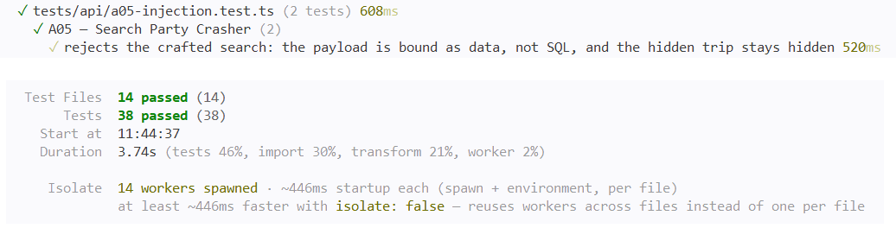

# A05 — Search Party Crasher

## Vulnerability

La recherche publique de voyages (`GET /api/trips`) construisait sa requête SQL en insérant directement le paramètre `q` dans le texte de la requête, par interpolation de template literal. Une valeur de recherche spécialement construite pouvait donc modifier la structure même de la requête, et pas seulement son contenu recherché.

Le seed contient un voyage non publié (`archive-search-party`, `is_published: false`), destiné aux tests internes. En modifiant le prédicat `WHERE`, j'ai pu faire ressortir ce voyage dans une recherche publique, sans aucune authentification, avec son flag dans la description (enregistré dans `flag.txt`).

L'impact est une injection SQL permettant de contourner un filtre métier (la publication des voyages) et de lire des données qui ne devraient jamais être exposées publiquement. Il s'agit d'une défaillance d'injection, OWASP Top 10:2025 A05 (Injection).

## Exploitation

Tout a été réalisé en local, en lecture seule, sans instruction empilée ni modification de données.

1. J'ai lancé une recherche ordinaire (`q=Kyoto`) et observé dans l'onglet Network la requête `GET /api/trips?q=Kyoto` et sa réponse normale.
2. J'ai lu le code de la route dans `apps/api/src/routes/catalog.ts` :

```ts
const filter = query
  ? ` AND (title ILIKE '%${query}%' OR destination ILIKE '%${query}%' OR description ILIKE '%${query}%')`
  : '';
const result = await pool.query(
  `SELECT ... FROM trips WHERE is_published=true${filter} ORDER BY departure_date`
);
```

`query` est injecté tel quel entre les apostrophes du `ILIKE`, sans aucune liaison de paramètres.

3. J'ai construit une valeur de `q` en trois temps : une apostrophe et une parenthèse fermante (`'`) pour sortir du groupe de recherche et refermer sa parenthèse, `OR 1=1` pour ajouter une condition toujours vraie, et `--` pour commenter le reste de la requête générée par le code :

```
q = ') OR 1=1 --
```

4. J'ai envoyé cette recherche :

```bash
curl -s "http://127.0.0.1:8080/api/trips?q=%27%29%20OR%201%3D1%20--%20" | python3 -m json.tool
```

5. La réponse contenait, en plus des voyages publiés, le voyage `archive-search-party` (« Dossier interne — ne pas publier »), avec `seats_available: 0` et le flag dans sa description.

Une fois la requête décomposée, le `WHERE` effectif devenait `(is_published=true AND title ILIKE '%') OR 1=1`, toujours vrai à cause de la priorité de `AND` sur `OR` : chaque ligne de la table était renvoyée, publiée ou non.

Preuve : `vulnerability.png` (réponse à la recherche piégée, contenant le voyage caché et le flag).

## Root Cause

**1. Construction de la requête par concaténation de chaînes.** La route insère directement `query` dans le texte SQL par interpolation. PostgreSQL ne distingue pas le texte voulu par le développeur de celui fourni par l'utilisateur : tout ce qui arrive dans la requête finale est interprété comme de la syntaxe SQL. En envoyant `') OR 1=1 --`, j'ai pu fermer la parenthèse du groupe de recherche, ajouter une condition toujours vraie et commenter le reste de la requête, ce qui a transformé le filtre `is_published=true AND (...)` en une condition toujours vraie pour chaque ligne.

**2. Un garde-fou qui filtre un caractère, pas une structure.** Le code refuse uniquement les requêtes contenant un point-virgule (`query.includes(';')`), dans l'intention d'empêcher des instructions empilées. Mais mon injection n'a jamais eu besoin de point-virgule : une seule instruction `SELECT`, modifiée par une apostrophe, un `OR` et un commentaire `--`, suffit à changer le prédicat `WHERE`. Un filtre sur un caractère précis ne peut pas anticiper toutes les façons de manipuler la syntaxe SQL ; il ne corrige pas la cause, qui est le mélange entre la structure de la requête et les données fournies par l'utilisateur.

**3. L'absence de liaison de paramètres, alors que le mécanisme existe déjà dans le projet.** D'autres routes du dépôt, comme `GET /api/bookings/:id`, passent leurs valeurs séparément du texte SQL, avec des marqueurs positionnels (`$1`) et un tableau de valeurs : `pool.query('SELECT ... WHERE id=$1', [id])`. Avec cette forme, `pg` envoie la requête et les valeurs séparément au serveur PostgreSQL : la valeur est toujours traitée comme une donnée, jamais comme du texte SQL à interpréter, même si elle contient des apostrophes ou des mots-clés SQL.

**Pourquoi un simple filtre de caractères ne suffit pas.** Tant que la valeur de recherche est concaténée dans le texte SQL, n'importe quel caractère ayant une signification en SQL peut potentiellement modifier la structure de la requête. Bloquer un caractère à la fois ne corrige pas la cause : il faudrait anticiper toutes les combinaisons possibles. La seule correction robuste est de séparer la structure de la requête des valeurs fournies par l'utilisateur, via la liaison de paramètres.

## Remediation

J'ai remplacé l'interpolation par une liaison de paramètres dans `apps/api/src/routes/catalog.ts` :

```ts
const filter = query ? ' AND (title ILIKE $1 OR destination ILIKE $1 OR description ILIKE $1)' : '';
const params = query ? [`%${query}%`] : [];

const result = await pool.query(
  `SELECT id,slug,title,destination,description,departure_date,return_date,price_cents,seats_available,image_key
   FROM trips
   WHERE is_published=true${filter}
   ORDER BY departure_date`,
  params
);
```

- **`$1` est réutilisé trois fois** dans le texte SQL (titre, destination, description), avec un seul élément dans le tableau de paramètres. `pg` substitue la même valeur liée à chacune de ses occurrences.
- **Le motif `%...%` est désormais construit côté JavaScript** (`` `%${query}% ``), avant d'être passé comme valeur du paramètre, et non plus dans le texte SQL. C'est le changement essentiel : la valeur part séparément du texte de la requête, donc elle ne peut plus en modifier la structure, quel que soit son contenu (apostrophes, `OR`, `--`).
- **J'ai supprimé le filtre `query.includes(';')`.** Avec des requêtes paramétrées, `pg` utilise le protocole étendu de PostgreSQL, qui n'exécute qu'une seule instruction par appel : les instructions empilées sont structurellement impossibles, peu importe le contenu de la valeur. Le filtre sur `;` ne protégeait donc plus rien après la correction ; le garder aurait été du code mort, et aurait bloqué sans raison une recherche légitime contenant un point-virgule.

La logique de recherche (titre, destination ou description, insensible à la casse) et le comportement sans terme de recherche restent inchangés.

Après la correction, j'ai rejoué exactement la même recherche qu'au début (`q=') OR 1=1 --`) :

```bash
curl -i "http://127.0.0.1:8080/api/trips?q=%27%29%20OR%201%3D1%20--%20"
```

Résultat : `200 OK` avec `{"trips":[]}`. La requête reste valide syntaxiquement, mais ne renvoie plus aucun voyage, et surtout plus le voyage caché ni le flag. Un résultat vide est le comportement attendu : la valeur de recherche, prise comme une donnée, ne correspond à aucun voyage publié.

Preuve : `remediation.png` (même recherche, `200` avec un tableau vide).

## Verification

J'ai réécrit `tests/api/a05-injection.test.ts`. L'ancien double de pool décidait de la ligne à renvoyer en inspectant le texte SQL (`sql.includes('OR 1=1')`), ce qui ne pouvait plus fonctionner après la correction puisque le texte SQL ne change plus selon la saisie. Je l'ai remplacé par un double plus réaliste, qui simule le filtrage `WHERE is_published=true AND (... ILIKE $1 ...)` à partir du paramètre reçu, sur un petit jeu de deux voyages fictifs (un publié, un non publié).

Le fichier contient deux tests :

- **Régression de sécurité** : j'envoie la recherche piégée (`q = "%' OR 1=1) -- "`) et je vérifie trois choses à la fois : la réponse est `200` sans `FLAG{` ni `archive-search-party` dans le corps (un résultat vide est valide, comme le précise le briefing) ; le texte SQL envoyé à `pool.query` ne contient jamais de fragment du payload (`OR 1=1`, `--`) ; et le paramètre lié contient la valeur malveillante intacte, telle que construite par le code (`` `%${query}%` ``, après le `trim()` appliqué par `readText`). Ces trois vérifications prouvent ensemble que la valeur a été traitée comme une donnée et jamais comme du SQL.
- **Test métier positif** : une recherche ordinaire (`q=Kyoto`) renvoie toujours le voyage correspondant, et le voyage caché n'apparaît jamais, quel que soit le terme recherché, puisqu'il n'est pas publié.

J'ai exécuté la suite complète dans Docker (`docker compose build app` puis `docker compose run --rm --no-deps app npm test`) : 14 fichiers de tests et 38 tests passent, sans régression sur les autres défis.

Preuve : `passing-tests.png` (suite complète au vert, dont les deux tests A05).

