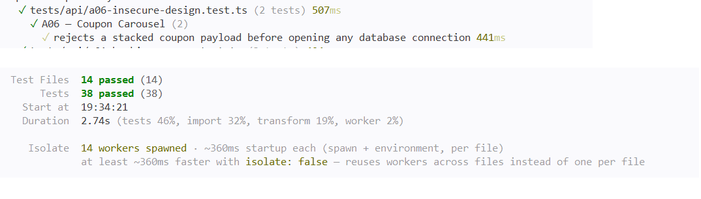

# A06 — Coupon Carousel

## Vulnerability

La création de réservation (`POST /api/bookings`) acceptait un champ `couponCode` censé contenir un seul code promotionnel, mais le backend le traitait comme une liste, séparée par des virgules. Rien n'empêchait d'y répéter le même code plusieurs fois, ni d'en fournir plusieurs différents. Chaque code présent dans la liste était ensuite appliqué, l'un après l'autre, sur le total déjà réduit par le précédent.

Avec le voyage de Lisbonne (64 900 centimes, 1 voyageur) et le coupon `BIENVENUE10` (-10 %) envoyé deux fois (`couponCode: "BIENVENUE10, BIENVENUE10"`), le total obtenu était de `52 569` centimes. Le flag n'apparaissait que dans la réponse immédiate de création (jamais dans une relecture ultérieure de la réservation), enregistré dans `flag.txt`.

L'impact est un contournement du prix prévu par le moteur de tarification, qui n'a jamais correctement défini ce qu'il devait se passer lorsque plusieurs coupons arrivent ensemble. Il s'agit d'une défaillance de conception, OWASP Top 10:2025 A06 (Insecure Design).

## Exploitation

Tout a été réalisé en local, avec le compte d'Alice et le catalogue fictif uniquement.

1. J'ai créé une réservation normale (Lisbonne, 1 voyageur) avec un seul coupon `BIENVENUE10`, et j'ai noté son `total_cents` comme base de comparaison.
2. J'ai lu le code de `POST /api/bookings` dans `apps/api/src/routes/bookings.ts` :

```ts
const couponCodes = readText(body.couponCode, 120)
  .toUpperCase()
  .split(',')
  .map(code => code.trim())
  .filter(Boolean);
```

`couponCode` est découpé sur la virgule, donc un champ qui n'affiche qu'une seule saisie dans l'interface peut en réalité contenir plusieurs codes.

3. J'ai refait une réservation sur le même voyage et le même nombre de voyageurs, cette fois avec `couponCode: "BIENVENUE10, BIENVENUE10"` dans le payload de `POST /api/bookings`.
4. La réponse immédiate contenait un `total_cents` de `52 569`, et le flag dans `itinerary_notes`.

Le calcul confirme le mécanisme : `64900 × 0,9 × 0,9 = 52569`. La réduction ne s'additionne pas simplement (ce qui aurait donné -20 %, soit 51 920), elle se compose multiplicativement à chaque passage dans la boucle de traitement des coupons : un coupon de 10 % répété deux fois produit en réalité environ 19 % de réduction (`1 − 0,9²`).

Preuve : `vulnerability.png` (payload avec le coupon dupliqué et réponse contenant le total réduit et le flag).

## Root Cause

**1. Un décalage entre ce que l'interface suggère et ce que le backend accepte.** L'interface propose un seul champ de saisie pour « un code » promotionnel, ce qui laisse croire qu'une réservation ne peut porter qu'un coupon. Mais côté serveur, le champ reçu est découpé avec `.split(',')`, et produit un tableau `couponCodes` pouvant contenir zéro, un ou plusieurs éléments. Rien dans l'interface ne communique ce comportement au client ordinaire, mais rien non plus, côté API, n'empêche d'envoyer directement plusieurs codes sans passer par l'interface.

**2. Une boucle sans aucune limite sur le nombre ni l'unicité des codes.** Le code appliquait ensuite chaque entrée du tableau, l'une après l'autre, sur le total déjà réduit par la précédente :

```ts
for (const couponCode of couponCodes) {
  ...
  total = applyCoupon(total, { discountPercent: coupon.discount_percent, minimumCents: coupon.minimum_cents });
  await client.query('UPDATE coupons SET uses=uses+1 WHERE id=$1', [coupon.id]);
}
```

Rien ne vérifiait que `couponCodes.length` valait au plus 1, et rien ne vérifiait que ses éléments étaient uniques.

**3. Le contrôle `uses<max_uses` limite l'usage global du coupon, pas sa répétition dans une même réservation.** La requête de chaque itération vérifiait `uses<max_uses` avant d'accepter le code, puis incrémentait `uses` immédiatement après. Ce compteur suit combien de fois un coupon a été utilisé au total, toutes réservations confondues : il permettait donc à la deuxième itération de passer, tant que `max_uses` n'était pas atteint. Ce mécanisme protège contre l'épuisement global d'un coupon ; il n'a jamais été conçu pour garantir qu'un seul coupon s'applique à une réservation donnée, et il ne joue aucun rôle dans cette faille.

**4. Une règle métier absente du code, pas une faille dans une validation existante.** À la différence d'A05 (où une protection existait mais était mal implémentée), aucune règle n'énonçait, nulle part dans le code, qu'une réservation ne peut porter que zéro ou un coupon éligible. Il n'y avait ni validation, ni commentaire, ni test exprimant cette intention : le workflow de réservation n'avait simplement jamais décidé ce qui devait se passer quand plusieurs codes arrivent ensemble. La correction ne consiste donc pas à réparer un contrôle existant, mais à formuler et appliquer explicitement, côté serveur, la règle « au plus un coupon éligible par réservation ».

## Remediation

J'ai ajouté un garde-fou explicite dans `apps/api/src/routes/bookings.ts`, juste après la validation existante de `tripId` et `travelers`, et **avant** `pool.connect()` / `BEGIN` :

```ts
if (couponCodes.length > 1) {
  return reply.code(400).send({ error: 'Un seul coupon est autorisé par réservation' });
}
```

Ce placement est délibéré : un rejet après l'ouverture de la transaction aurait déjà exécuté au moins une requête (`SELECT * FROM trips ... FOR UPDATE`), ce qui pose un verrou et constitue une opération à éviter pour un rejet sans écriture. En rejetant avant toute connexion à la base, aucune requête SQL n'est émise, qu'il s'agisse de doublons (`"BIENVENUE10, BIENVENUE10"`) ou de codes distincts empilés (`"BIENVENUE10, FJORD15"`) : la même règle couvre les deux cas, sans détection d'unicité spécifique.

J'ai aussi retiré le code devenu mort une fois cette règle en place : la variable `hasMultipleCoupons`, la branche conditionnelle sur `itinerary_notes`, et l'injection du flag dans la réponse. Comme `couponCodes.length` ne peut plus dépasser 1 à ce stade, cette branche n'aurait plus jamais pu s'exécuter.

Le reste du code est inchangé : le helper `applyCoupon`, le calcul du prix côté serveur, la transaction, le verrouillage `FOR UPDATE` et l'audit restent identiques. Un nouveau modèle de base de données pour les coupons n'était pas nécessaire.

Après la correction, j'ai rejoué exactement la même action qu'au début (`couponCode: "BIENVENUE10, BIENVENUE10"` sur le même voyage) : `400 Bad Request` avec `{"error": "Un seul coupon est autorisé par réservation"}`.

Preuve : `remediation.png` (même payload, désormais rejeté avec un `400`).

## Verification

J'ai mis à jour `tests/api/a06-insecure-design.test.ts`, qui contient deux tests :

- **Régression de sécurité** : la requête avec le coupon dupliqué reçoit `400`, et le corps ne contient pas `FLAG{`. La preuve de l'absence d'écriture est apportée directement sur le double de pool : `fake.pool.connect` et `fake.client.query` n'ont jamais été appelés (`not.toHaveBeenCalled()`). Comme `pool.connect()` n'est appelé que si le code atteint la transaction, prouver qu'il n'a jamais été sollicité démontre, de façon structurelle, qu'aucune requête SQL (`BEGIN`, `INSERT`, `UPDATE`) n'a pu se produire — une preuve plus directe qu'une vérification après coup de l'état de la base.
- **Test métier positif** : une réservation avec un seul coupon valide reçoit toujours `201`, avec le total correctement réduit (`90 000` centimes), et sans flag dans la réponse.

J'ai exécuté la suite complète dans Docker (`docker compose build app` puis `docker compose run --rm --no-deps app npm test`) : 14 fichiers de tests et 38 tests passent, sans régression sur les autres défis.

Preuve : `passing-tests.png` (suite complète au vert, dont les deux tests A06).

