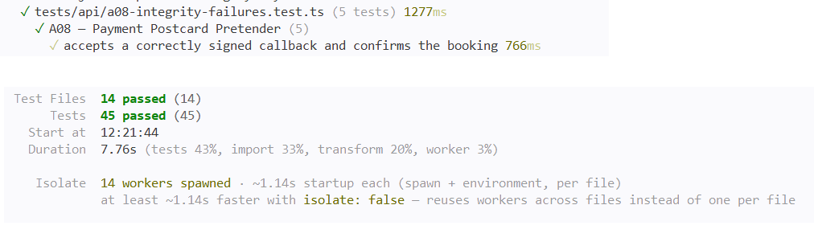

# A08 — Payment Postcard Pretender

## Vulnerability

HolbieTrips expose deux chemins pour confirmer le paiement d'une réservation. Le checkout normal (`POST /api/bookings/:id/pay`) appelle lui-même le simulateur de paiement et vérifie une signature HMAC sur sa réponse avant d'écrire quoi que ce soit. Mais il existe une seconde route, `POST /api/payments/callback`, destinée à recevoir une notification d'un fournisseur de paiement : elle est publique (aucune authentification), et ne vérifiait que la **forme** des champs reçus (un UUID valide, un entier, une chaîne de longueur suffisante, quatre chiffres), jamais leur **origine**.

En soumettant un payload forgé avec l'identifiant d'une réservation `pending` et son montant exact — deux valeurs non secrètes, visibles côté client — j'ai pu confirmer la réservation de Bruno sans aucune signature, aucune session, aucune preuve que le message venait réellement du simulateur de paiement. La réponse contenait le flag (enregistré dans `flag.txt`).

L'impact est une confirmation frauduleuse de paiement : n'importe qui connaissant (ou devinant) l'identifiant et le montant d'une réservation en attente peut la faire passer à `confirmed` sans jamais payer. Il s'agit d'une défaillance d'intégrité logicielle et de données, OWASP Top 10:2025 A08 (Software and Data Integrity Failures).

## Exploitation

Tout a été réalisé en local, avec la réservation de démonstration de Bruno (`HT-BRUNO-001`, id `40000000-0000-4000-8000-000000000002`, `total_cents = 129900`, statut `pending`, trip « fjords Norvège »), sans paiement réel ni arrêt de service.

1. J'ai lu les deux routes dans `apps/api/src/routes/payments.ts` et comparé leurs contrôles : `/pay` vérifie `validSignature(signedFields, payment.signature, settings.paymentKey)` avant d'écrire, `/callback` ne vérifie que la forme des champs.
2. J'ai identifié la réservation de démonstration `pending` via les seeds (`database/seeds/001_demo.sql`).
3. J'ai construit et envoyé un payload non signé directement vers le callback, sans authentification :

```bash
curl -s -X POST http://127.0.0.1:8080/api/payments/callback \
  -H "content-type: application/json" \
  -d '{"bookingId":"40000000-0000-4000-8000-000000000002","amountCents":129900,"status":"approved","providerReference":"FAKE-REF-001","cardLast4":"4242"}'
```

4. La réponse a été `{"status":"confirmed","flag":"FLAG{a08_077f4c7861232c84fad2d1c7}"}` : la réservation de Bruno a été confirmée par ce message forgé, sans qu'aucun paiement n'ait réellement eu lieu.

Preuve : `vulnerability.png` (payload envoyé et réponse avec le flag, aucun token de session dans cette requête).

## Root Cause

**1. Deux entrées équivalentes, une seule protégée (`apps/api/src/routes/payments.ts`).** Les deux routes écrivent dans les mêmes tables (`payments`, `bookings`). Le checkout normal protège cette écriture avec `validSignature`, calculée avec une clé partagée (`settings.paymentKey`) connue uniquement de l'API et du simulateur de paiement. Le callback, lui, ne faisait aucune vérification de ce type : il traitait n'importe quel appelant comme un fournisseur de paiement légitime, du moment que les champs avaient la bonne forme.

**2. Un identifiant et un montant corrects ne prouvent pas une origine.** `bookingId` et `amountCents` sont des informations que n'importe qui ayant consulté sa propre réservation (ou simplement devinant un UUID et un montant plausible) peut connaître. Vérifier que ces champs correspondent à une réservation `pending` en base montre une cohérence interne, pas qui a envoyé le message. C'est la différence entre une preuve de cohérence et une preuve d'authenticité : seule une signature HMAC, produite avec un secret partagé, apporte la seconde.

**3. L'absence d'authentification sur la route elle-même n'était pas en soi le problème.** Un vrai fournisseur de paiement externe n'a jamais de session utilisateur HolbieTrips : exiger `context.requireUser` sur ce callback n'aurait eu aucun sens métier. Le défaut n'était donc pas l'absence de connexion, mais l'absence du mécanisme d'authentification adapté à un échange service-à-service : une signature, pas un token de session.

**4. Un défaut de protection contre le rejeu, indépendant de la signature.** La requête `SELECT id,total_cents FROM bookings WHERE id=$1 AND total_cents=$2 AND status='pending'` se faisait hors transaction, sur `pool` plutôt que sur une connexion verrouillée, et l'`UPDATE bookings SET status='confirmed' WHERE id=$1` ne vérifiait plus le statut au moment de l'écriture. De plus, la clause `ON CONFLICT(booking_id) DO UPDATE ... status='approved'` permettait de réécrire silencieusement la ligne de paiement à chaque appel. Même après avoir ajouté une signature, deux appels concurrents auraient pu tous les deux lire `status='pending'` avant qu'aucun n'ait écrit `confirmed`, ce qui aurait laissé la fenêtre ouverte à une confirmation en double.

**Pourquoi corriger un seul point ne suffit pas.** Ajouter uniquement la vérification de signature empêche un appelant arbitraire de forger un payload, mais ne protège pas contre le rejeu d'un message *légitimement signé* une fois déjà traité (par exemple si un vrai fournisseur renvoyait deux fois la même notification, ou si un attaquant interceptait et rejouait un message intercepté). Il fallait donc à la fois authentifier l'origine (la signature) et rendre l'opération idempotente et atomique (le verrouillage transactionnel), pour que seules des confirmations correctement signées, concordantes et non rejouées changent l'état d'une réservation.

## Remediation

J'ai réutilisé le mécanisme de signature déjà présent dans le projet (`paymentSignature`/`validSignature` de `apps/api/src/security.ts`), sans rien réinventer, et restructuré la route pour éliminer la fenêtre de rejeu :

- **Vérification de signature avant tout accès à la base** : la route calcule `signedFields = { bookingId, amountCents, status, providerReference, cardLast4 }` (exactement les mêmes champs, dans le même ordre, que le checkout normal) et appelle `validSignature(signedFields, signature, settings.paymentKey)`. Un échec renvoie `401`, avec un audit, avant même de révéler si la réservation existe.
- **Transaction avec verrouillage** : le `SELECT` qui vérifie la réservation est déplacé dans la transaction, avec `FOR UPDATE`, immédiatement suivi des écritures (`INSERT INTO payments`, `UPDATE bookings SET status='confirmed'`). Ce verrouillage empêche deux appels concurrents de confirmer la même réservation deux fois, et garantit qu'une réservation déjà `confirmed` échoue systématiquement au `SELECT ... WHERE status='pending'` (rejeu séquentiel bloqué, `404`, état inchangé).
- **Suppression du flag pédagogique** : la réponse d'une confirmation réussie est désormais simplement `{ status: 'confirmed' }`.
- **Code inchangé** : le checkout normal (`/pay`), le helper `applyCoupon`, et la clause `ON CONFLICT` restent identiques ; cette dernière devient sans incidence une fois le verrouillage en place, puisqu'elle n'est plus jamais atteinte pour une réservation déjà confirmée.

Après la correction, j'ai restauré les données de démonstration (`docker compose down -v` puis `docker compose up --build -d`, pour que la réservation de Bruno redevienne `pending`), puis rejoué exactement la même tentative non signée qu'au début. La réponse a été `401 Unauthorized` avec `{"error":"Signature de confirmation invalide"}`, sans flag.

Preuve : `remediation.png` (même payload qu'au début, désormais rejeté).

## Verification

J'ai écrit `tests/api/a08-integrity-failures.test.ts`, avec cinq tests qui couvrent précisément les cas demandés par la landing condition :

- **Test métier positif** : un callback correctement signé (avec la valeur de repli de `settings.paymentKey` utilisée par défaut en test, puisque `buildApp()` ne permet pas de la surcharger) confirme bien la réservation, renvoie `200` et `{ status: 'confirmed' }`, sans flag.
- **Régression — non signé** : un callback sans champ `signature` est rejeté avec `401`, et l'état de la réservation reste `pending`.
- **Régression — altéré** : un callback signé puis modifié après coup (montant changé) est rejeté avec `401`, car la signature ne correspond plus aux champs reçus.
- **Régression — non concordant** : un callback valablement signé mais portant un montant différent de celui réellement stocké en base est rejeté avec `404`, sans changer l'état de la réservation.
- **Régression — rejeu** : un callback valablement signé, envoyé contre une réservation déjà `confirmed`, est rejeté avec `404`, et la réservation reste `confirmée` sans être retraitée.

Le double de base de données utilisé par les tests lit les paramètres réellement envoyés à chaque requête SQL (plutôt que de comparer à des valeurs figées), pour que le test « non concordant » prouve bien que la valeur falsifiée du payload a été transmise jusqu'à la requête et rejetée pour de bonnes raisons, pas par accident de configuration du double.

J'ai exécuté la suite complète dans Docker (`docker compose build app` puis `docker compose run --rm --no-deps app npm test`) : 14 fichiers de tests et 45 tests passent, sans régression sur les autres défis. Le checkout normal (`/pay`) n'est pas modifié par ce correctif et n'a pas de test automatisé dédié dans ce dépôt ; je l'ai vérifié manuellement en inspectant le code, qui reste identique à l'original.

Preuve : `passing-tests.png` (suite complète au vert, dont les cinq tests A08).

