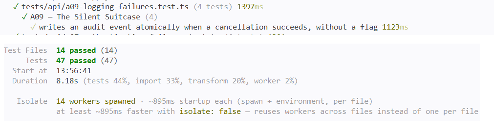

# A09 — The Silent Suitcase

## Vulnerability

La route d'annulation de réservation (`POST /api/bookings/:id/cancel`) modifiait l'état d'une réservation (`status='cancelled'`) sans jamais écrire d'événement d'audit, contrairement aux routes voisines du même fichier (`booking.created` dans `POST /api/bookings`) ou du module support (`support.ticket_created`, `support.ticket_updated`), qui appellent toutes `recordAudit()`.

Le flux d'audit réservé au support (`GET /api/audit`) est censé permettre de reconstituer qui a modifié quelle réservation, quand, et avec quel résultat. Une annulation réussie n'y laissait aucune trace : la réponse de succès sur l'écran du voyageur n'était pas, et ne remplaçait pas, cet historique de sécurité.

En annulant une réservation possédée (Alice, `HT-ALICE-001`), j'ai obtenu une confirmation immédiate dans la réponse de l'API, incluant le flag (enregistré dans `flag.txt`), alors qu'aucun enregistrement correspondant n'apparaissait ensuite dans `GET /api/audit` consulté en tant que support.

L'impact est une perte de traçabilité sur une action sensible du cycle de vie d'une réservation : le support ne peut ni confirmer qui a annulé une réservation, ni enquêter sur un schéma d'annulations suspect (par exemple des tentatives répétées sur des réservations appartenant à d'autres voyageurs). Il s'agit d'une défaillance de journalisation et de supervision de sécurité, OWASP Top 10:2025 A09 (Security Logging and Monitoring Failures).

## Exploitation

Tout a été réalisé en local, avec une réservation possédée par le client de démonstration actif (Alice).

1. Je me suis connecté en Alice et j'ai annulé l'une de ses réservations :

```bash
curl -s -X POST http://127.0.0.1:8080/api/bookings/<ID_RESERVATION>/cancel \
  -H "authorization: Bearer <TOKEN_ALICE>"
```

2. La réponse a confirmé l'annulation et contenait le flag :

```json
{"booking":{"id":"...","reference":"...","status":"cancelled"},"flag":"FLAG{a09_...}"}
```

3. J'ai lu le code de la route dans `apps/api/src/routes/bookings.ts` : elle utilisait `pool.query` directement, sans transaction et sans aucun appel à `recordAudit()`.
4. Je me suis connecté en tant que support (`support@holbietrips.test`) et j'ai interrogé le flux d'audit :

```bash
curl -s http://127.0.0.1:8080/api/audit \
  -H "authorization: Bearer <TOKEN_SUPPORT>"
```

Aucun événement lié à cette annulation n'apparaissait dans la liste, alors que l'action avait bien eu lieu (la réservation était bien passée à `cancelled`). Seul l'événement `booking.created` de la création initiale de la réservation était visible, pas l'annulation elle-même.

Preuve : `vulnerability.png` (réponse de l'annulation avec le flag, token masqué).

## Root Cause

**1. Une route qui n'appelle jamais le helper d'audit partagé (`apps/api/src/routes/bookings.ts`).** `recordAudit()`, défini dans `apps/api/src/lib/audit.ts`, est déjà utilisé par les routes voisines (`booking.created`, `support.ticket_created`, `support.ticket_updated`). La route de cancellation n'en faisait jamais usage : elle exécutait un simple `UPDATE bookings SET status='cancelled' WHERE id=$1 AND user_id=$2 AND status<>'cancelled'` sur `pool`, sans jamais écrire d'événement.

**2. Une action métier légitime silencieuse à la fois en succès et en échec.** L'absence de trace ne concernait pas seulement les annulations réussies : une tentative refusée (réservation inexistante, appartenant à un autre voyageur, ou déjà annulée) renvoyait un simple `404`, sans non plus laisser de trace exploitable par le support. Or une tentative refusée sur la réservation d'un autre voyageur est potentiellement le signe d'un comportement suspect (le même type d'accès non autorisé que celui démontré en A01), et devrait être distinguable d'un simple double-clic sur une réservation déjà annulée.

**3. Pas une erreur d'implémentation d'un contrôle existant, mais une omission.** Comme pour A06, il ne s'agissait pas d'une protection mal appliquée, mais d'une action sensible pour laquelle personne n'avait prévu de laisser de trace. Le mécanisme (`recordAudit`) existait déjà et fonctionnait correctement ailleurs dans le même fichier ; il suffisait de l'appliquer à cette route.

**Pourquoi ajouter une trace de succès seule ne suffit pas.** Journaliser uniquement les annulations réussies aurait laissé le support incapable de détecter des tentatives suspectes refusées (par exemple des essais répétés sur des réservations d'autres voyageurs). Il fallait donc journaliser les deux issues — succès et refus — tout en gardant le même message d'erreur générique côté client dans tous les cas de refus, pour ne pas révéler à un appelant si une réservation existe ou appartient à quelqu'un d'autre.

## Remediation

J'ai réécrit `POST /api/bookings/:id/cancel` pour qu'elle :

- **Lise la réservation dans une transaction avec verrouillage** (`SELECT id,user_id,status,reference FROM bookings WHERE id=$1 FOR UPDATE`), avant toute décision, pour éliminer tout risque de TOCTOU entre la lecture et l'écriture (même principe que la correction d'A08).
- **Distingue trois causes de refus** sans requête supplémentaire : réservation introuvable (`reason: 'not-found'`), réservation appartenant à un autre utilisateur (`reason: 'not-owned'`), réservation déjà annulée (`reason: 'already-cancelled'`). Dans les trois cas, un événement `booking.cancel_denied` est écrit avec cette raison en métadonnée, et la réponse HTTP reste le même `404` générique (`Réservation annulable introuvable`) quel que soit le cas — la distinction ne vit que dans l'audit, consultable uniquement par le rôle `support`.
- **Écrit un événement `booking.cancelled` pour le cas de succès**, avec la référence de la réservation en métadonnée.
- **Valide l'ensemble dans la même transaction** (`BEGIN`/`COMMIT`/`ROLLBACK`) : le changement d'état de la réservation et l'enregistrement d'audit correspondant (succès ou refus) sont validés ou annulés ensemble, quel que soit le résultat.
- **Supprime le flag pédagogique** de la réponse de succès.

Je n'ai pas modifié `recordAudit()` ni les autres routes du fichier : le mécanisme était déjà correct, il manquait seulement d'être appelé ici.

Après la correction, j'ai créé une réservation fraîche pour Alice (la réservation seedée d'origine étant déjà annulée par la démonstration de la faille), je l'ai annulée, et j'ai vérifié les deux côtés du comportement :

1. La réponse de l'annulation ne contenait plus de flag : `{"booking":{"id":"...","status":"cancelled"}}`.
2. L'événement correspondant apparaissait bien dans `GET /api/audit` consulté en support :

```json
{
  "action": "booking.cancelled",
  "entity_type": "booking",
  "entity_id": "15398cf3-9a7b-451f-b53c-2e72f7a25cd8",
  "metadata": { "reference": "HT-MV9S1DXB-C2004" },
  "created_at": "2026-10-15T16:52:51.019Z",
  "email": "alice.martin@example.test"
}
```

Cet événement contient l'acteur (l'e-mail d'Alice), l'action, la cible (l'identifiant de la réservation), l'heure, et une métadonnée non sensible — aucun secret ni information interne.

Preuve : `remediation.png` (réponse d'annulation sans flag, et événement d'audit correspondant consulté côté support).

## Verification

J'ai mis à jour `tests/api/a09-logging-failures.test.ts`, avec un double de pool à état simulant une table `bookings` et la séquence transactionnelle (`BEGIN` → `SELECT ... FOR UPDATE` → `UPDATE`/`INSERT INTO audit_events` → `COMMIT`). Le fichier contient quatre tests :

- **Test métier positif** : l'annulation d'une réservation possédée réussit (`200`), sans flag, et un seul événement `booking.cancelled` est écrit avec la bonne référence en métadonnée, dans la même transaction que la mutation.
- **Régression — réservation introuvable** : la tentative d'annuler un identifiant inexistant renvoie `404`, sans aucune mutation possible (aucune ligne à modifier), et un événement `booking.cancel_denied` avec `reason: 'not-found'` est écrit.
- **Régression — réservation d'un autre voyageur** : la tentative d'Alice d'annuler la réservation de Bruno renvoie `404`, la réservation de Bruno reste `pending` (aucune mutation), et l'événement d'audit distingue ce cas précis avec `reason: 'not-owned'` — le cas le plus proche d'un signal de comportement suspect pour le support.
- **Régression — réservation déjà annulée** : le rejeu d'une annulation sur une réservation déjà `cancelled` renvoie `404`, sans nouvelle mutation, avec `reason: 'already-cancelled'`.

J'ai exécuté la suite complète dans Docker (`docker compose build app` puis `docker compose run --rm --no-deps app npm test`) et vérifié que l'ensemble des tests passe, sans régression sur les autres défis.

Preuve : `passing-tests.png` (suite complète au vert, dont les quatre tests A09).

