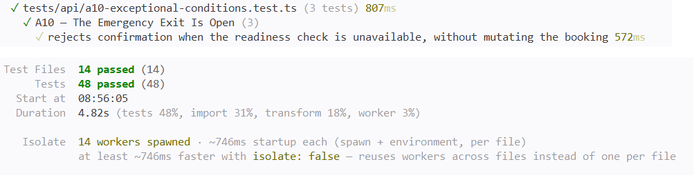

# A10 — The Emergency Exit Is Open

## Vulnerability

La confirmation finale d'une réservation (`POST /api/bookings/:id/confirm`) a une condition obligatoire : la réservation doit être `pending` et son paiement `approved`. Le code calculait correctement cette condition, mais si une exception survenait pendant la vérification — qu'elle soit simulée ou réelle (panne de base de données, erreur réseau, indisponibilité d'un service de dépendance) — le bloc `catch` traitait cette incertitude comme une approbation : `checksPassed = true`.

En déclenchant le mode de simulation local sur une réservation fraîche, non payée, j'ai obtenu une confirmation immédiate et le flag, alors que la réservation n'avait jamais été payée. Il s'agit d'un comportement « fail open » : l'absence de preuve que la condition est remplie a été traitée comme une preuve positive, au lieu d'être traitée comme un refus.

L'impact est la confirmation de réservations non payées dès que le contrôle de disponibilité devient momentanément indisponible, contournant ainsi la condition de paiement censée protéger chaque confirmation. Il s'agit d'une défaillance de gestion des conditions exceptionnelles, OWASP Top 10:2025 A10 (Mishandling of Exceptional Conditions).

## Exploitation

Tout a été réalisé en local, avec une réservation fraîche possédée par Alice, sans arrêt de conteneur ni perturbation d'autre service.

1. Je me suis connecté en Alice et j'ai créé une nouvelle réservation, sans la payer :

```bash
curl -s -X POST http://127.0.0.1:8080/api/bookings \
  -H "authorization: Bearer <TOKEN_ALICE>" \
  -H "content-type: application/json" \
  -d '{"tripId":"20000000-0000-4000-8000-000000000004","travelers":1}'
```

2. J'ai essayé une confirmation normale, sans simulation, pour observer le comportement attendu :

```bash
curl -s -X POST http://127.0.0.1:8080/api/bookings/<ID_RESERVATION>/confirm \
  -H "authorization: Bearer <TOKEN_ALICE>" \
  -H "content-type: application/json" \
  -d '{}'
```

La réservation n'étant pas payée, la réponse a correctement refusé la confirmation.

3. J'ai ensuite déclenché le mode de simulation fourni pour cet exercice, sur la même réservation non payée :

```bash
curl -s -X POST http://127.0.0.1:8080/api/bookings/<ID_RESERVATION>/confirm \
  -H "authorization: Bearer <TOKEN_ALICE>" \
  -H "content-type: application/json" \
  -d '{"simulateCheckFailure": true}'
```

4. La réponse a été `{"status":"confirmed","flag":"FLAG{a10_f895e45c0ba28b6bdb6d62ed}"}` : la réservation a été confirmée malgré l'absence de paiement, uniquement parce que le contrôle avait levé une exception.

Preuve : `vulnerability.png` (réponse de confirmation avec le flag, token masqué).

## Root Cause

**1. Une exception traitée comme une approbation implicite (`apps/api/src/routes/bookings.ts`).** Le code initialisait `checksPassed = false`, calculait la condition métier réelle dans un bloc `try`, mais le bloc `catch` écrasait cette valeur à `true` dès qu'une exception quelconque survenait :

```ts
let checksPassed = false;
try {
  if (simulateFailure) throw new Error('Local readiness checker unavailable');
  checksPassed = result.rows[0].status === 'pending' && result.rows[0].payment_status === 'approved';
} catch {
  checksPassed = true;
}
```

La simulation locale déclenche cette branche, mais le `catch` ne faisait aucune distinction sur la cause de l'exception : une panne de base de données ou une erreur réseau aurait produit exactement le même résultat. C'est un comportement « fail open », contraire au principe de sécurité par défaut selon lequel une action sensible doit refuser l'action en cas d'incertitude, jamais l'autoriser.

**2. Aucune distinction entre « condition non remplie » et « condition impossible à vérifier », alors que les deux doivent aboutir au même refus.** Une réservation réellement non payée était correctement rejetée (`409`), mais un vérificateur indisponible confirmait la réservation. Pourtant, dans les deux cas, rien ne prouvait que le paiement était approuvé : dans le premier cas parce que la donnée disait explicitement non, dans le second parce que la donnée n'avait simplement pas pu être lue. L'absence de preuve ne devrait jamais valoir preuve positive.

**Pourquoi corriger uniquement le champ de simulation n'aurait pas suffi.** Retirer `simulateCheckFailure` du code aurait empêché de reproduire la démonstration, mais n'aurait rien changé à la logique du `catch` : une vraie exception future aurait toujours déclenché `checksPassed = true`. La faille aurait simplement perdu son interrupteur de démonstration locale, sans être corrigée dans le code qui gère réellement les erreurs.

## Remediation

J'ai modifié la gestion des exceptions dans `POST /api/bookings/:id/confirm` :

- **`checksPassed` reste `false` en cas d'exception** (sa valeur initiale n'est jamais écrasée par le `catch`), ce qui garantit un comportement fail-closed : toute incertitude se traduit par un refus, jamais par une approbation.
- **Distinction entre deux causes de refus**, avec un booléen séparé `checkUnavailable` : le refus métier normal (réservation non `pending` ou paiement non `approved`) reste un `409`, tandis qu'une incertitude due à une exception du contrôle devient un `503 Service Unavailable`, avec le message générique « Vérification indisponible, veuillez réessayer » — non sensible (il ne révèle jamais le détail technique de l'exception, comme `Local readiness checker unavailable`) et explicitement retryable.
- **Journalisation côté serveur** : l'exception est consignée via `app.log.warn({ bookingId: id, error }, ...)`, pour que l'incident reste visible et investigable en interne, sans jamais apparaître dans la réponse HTTP.
- **Aucune mutation en cas de refus** : ni le cas `checkUnavailable`, ni le cas `!checksPassed`, n'atteignent `UPDATE bookings SET status='confirmed'` : l'état de la réservation reste inchangé dans les deux cas.
- **Suppression du flag pédagogique** : la réponse de succès ne contient plus `flag: flags.get('A10')`.

Après la correction, j'ai recréé une réservation fraîche pour Alice (la précédente étant déjà `confirmed` par la démonstration de la faille) et rejoué exactement la même tentative qu'au début :

```bash
curl -i -X POST http://127.0.0.1:8080/api/bookings/<NOUVEL_ID>/confirm \
  -H "authorization: Bearer <TOKEN_ALICE>" \
  -H "content-type: application/json" \
  -d '{"simulateCheckFailure": true}'
```

La réponse a été `503 Service Unavailable` avec `{"error":"Vérification indisponible, veuillez réessayer"}`, sans aucun flag, et la réservation est restée `pending`.

Preuve : `remediation.png` (même tentative qu'au début, désormais rejetée avec un `503`, sans flag).

## Verification

J'ai réécrit `tests/api/a10-exceptional-conditions.test.ts`, avec un double de pool à état simulant une table `bookings` dont le statut évolue selon les requêtes reçues. Le fichier contient trois tests :

- **Régression de sécurité** : avec `simulateCheckFailure: true` sur une réservation `pending` et non payée, la réponse est `503`, sans flag, le détail technique de l'exception n'apparaît jamais dans le corps de la réponse, et l'état de la réservation reste `pending` (aucune mutation).
- **Test métier existant préservé** : une confirmation normale (sans simulation) sur une réservation réellement non payée reste rejetée avec `409`, sans flag, sans mutation.
- **Test métier positif** : une réservation construite directement dans le double de pool avec `status: 'pending'` et `payment_status: 'approved'` (puisque le parcours normal de paiement confirme déjà automatiquement la réservation, et ne permet donc pas d'observer cet état intermédiaire) confirme normalement avec `200`, sans flag, et l'état passe bien à `confirmed`.

J'ai exécuté la suite complète dans Docker (`docker compose build app` puis `docker compose run --rm --no-deps app npm test`) et vérifié que l'ensemble de la suite passe, dont les trois tests A10, sans régression sur les autres défis.

Preuve : `passing-tests.png` (suite complète au vert, dont les trois tests A10).

